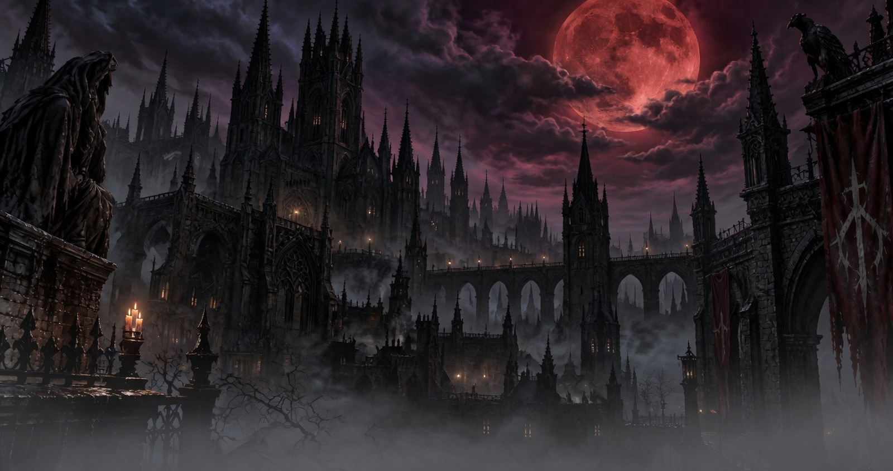

# Blood Moon

Blood Moon sets the desktop beneath a wounded moon. A cathedral city of black stone rises through fog, its spires needling a sky of bruised purple and storm cloud. Candle flames burn in the windows and along the bridges. A hooded figure keeps the left parapet, and a raven watches from the right, above banners the color of dried blood.

The palette follows that night. Backgrounds are near-black stone, the accent is the moon's dull red, and the text is the warm gray of mist lit by a candle. Icons are Yaru-red.



## Install

```bash
omarchy theme install https://github.com/Jmjcoke/omarchy-blood-moon-theme.git
```

The same URL works from the Omarchy menu: Install, then Style, then Theme.

Remove it with `omarchy theme remove blood-moon`.

## Included

- `colors.toml`, a dark palette of near-black stone, blood red, and candle-lit mist
- `icons.theme`, set to Yaru-red
- `backgrounds/1-cathedral.jpg`, a 3840×2030 wallpaper

## License

Theme configuration is released under the MIT License. See [LICENSE](LICENSE).
